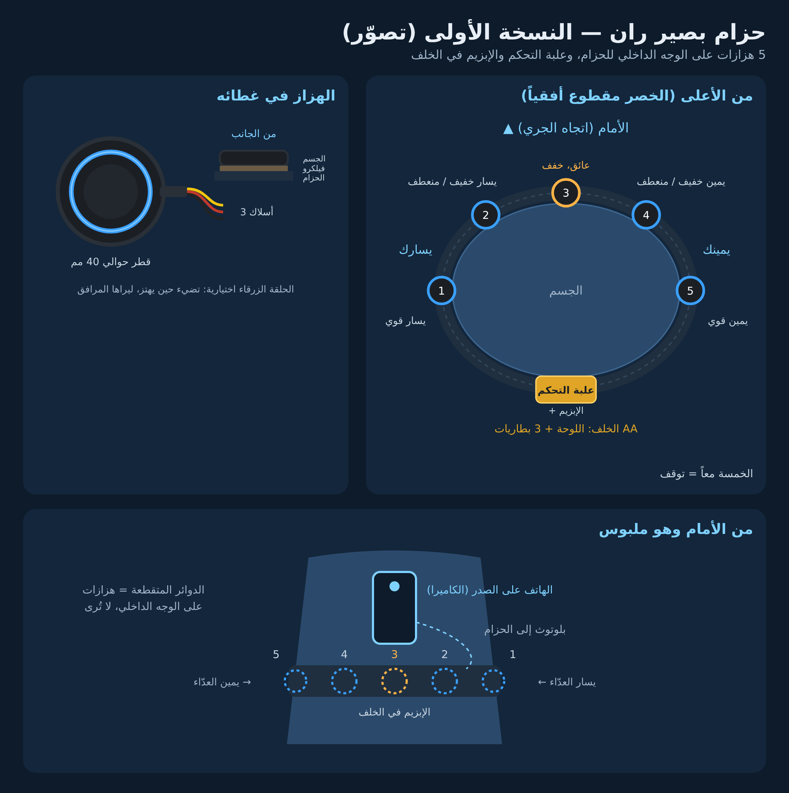

# لغة الحزام الاهتزازي — بصير ران (الإصدار الأول)

> الحالة: مصمَّمة ومبرمجة ومختبرة **على الحاسوب فقط** (اختبارات وحدات، وتطابق برنامج اللوحة مع التطبيق، وإعادة تشغيل
> أوامر مسجَّلة من 45 فيديو). **لم تُجرَّب بعد على حزام حقيقي ولا مع عدّاء كفيف.** لا تُعتبر صالحة للجري المستقل قبل
> الاختبارات الميدانية في القسم 8.

## 1. ثلاث قواعد فقط

1. **مكان الاهتزاز = الاتجاه.** محركات اليسار = اتجه/انعطف يساراً، محركات اليمين = يميناً، الوسط = أمامك.
   كلما ابتعد المحرك إلى الجانب كان التصحيح أكبر (المحرك 2 = تصحيح بسيط، المحرك 1 = تصحيح قوي).
2. **طريقة الاهتزاز = نوع الرسالة.** نبضة قصيرة = صحّح. حركة ناعمة عبر الحزام = الطريق ينحني. ثلاث نبضات سريعة في الأمام = شيء أمامك. المحركات الخمسة معاً = توقّف.
3. **السكون = أنت على المسار.** لا شيء يهتز ما دام كل شيء جيداً.

لماذا هذا الاختيار: في أبحاث أحزمة الخصر وُجد أن ربط الاتجاه **بموضع** الاهتزاز يُفهم دون تدريب تقريباً، بينما ترميز
المسافة بأنماط إضافية لم يحسّن الأداء، وأن الأقل عدداً من المحركات أفضل، بمسافات 8–10 سم بينها
(van Erp وآخرون 2005، Waypoint navigation with a vibrotactile waist belt، ACM TAP 2:106–117).
لذلك لا نعدّ النبضات للاتجاه على الحزام (كما في الهاتف: نبضة لليسار ونبضتان لليمين)، بل نستعمل المكان.

## 2. توزيع المحركات

| المحرك | المكان على الجسم | الزاوية من الأمام | دوره |
|---|---|---|---|
| M1 | الخاصرة اليسرى، فوق عظم الورك على النسيج الطري | 90° يسار | تصحيح قوي يساراً، «انعطف الآن» يساراً |
| M2 | أمام يسار، بين السرة والخاصرة | 45° يسار | تصحيح بسيط/متوسط يساراً، جهة تجاوز العائق |
| M3 | خط السرة (مرجع الجسم الطبيعي للوسط) | 0° | عائق أمامك، عدت إلى المسار، بداية حركة المنحنى |
| M4 | أمام يمين | 45° يمين | تصحيح بسيط/متوسط يميناً، جهة تجاوز العائق |
| M5 | الخاصرة اليمنى | 90° يمين | تصحيح قوي يميناً، «انعطف الآن» يميناً |

- المسافة بين كل محركين متجاورين: **9–11 سم** على خصر 70–90 سم (ضمن 8–10 سم المستعملة في الأبحاث). لا تقل عن 8 سم.
- **لا تضع محركاً على عظم الورك نفسه**: العظم ينقل الاهتزاز وينشره فيصعب تحديد مكانه ويزعج.
- المحركات **على الوجه الداخلي** للحزام، ملاصقة للجسم أو فوق قميص رقيق، والحزام مشدود (مطاطي) حتى لا ترتد.
- علبة التحكم والإبزيم **في الخلف**؛ بعيداً عن العمود الفقري قليلاً أو مع وسادة رقيقة.
- ثبّتها أول مرة بفيلكرو مؤقت، ثم استعمل «فحص المحركات» في التطبيق وحرّكها حتى تميّز كل محرك عن جاره وأنت تجري.

## 3. جدول الإشارات النهائي

الشدة: نسبة من القوة القصوى للمحرك قبل إعداد «قوة الحزام». «تشغيل/إيقاف» بالمللي ثانية.

| الإشارة | المعنى | المحركات | التوقيت (تشغيل/إيقاف) | الشدة | الأولوية |
|---|---|---|---|---|---|
| سكون | أنت على المسار | — | — | — | — |
| `back_on_path` | عدت إلى المسار | M3 | 60/90، 60 | 35 % | 1 استمرار |
| `correct_left_low` | تصحيح بسيط يساراً | M2 | 150 | 60 % | 2 توجيه |
| `correct_left_medium` | تصحيح متوسط يساراً | M2 | 220 | 85 % | 2 |
| `correct_left_high` | تصحيح قوي: أنت تخرج من المسار | M1 مرتين | 200/120، 200 | 100 % | 2 (يتجاوز التهدئة) |
| `curve_left_low/medium` | انحناء تدريجي يساراً قادم | M3 ← M2 | 180/20، 180 | 45 % | 2 |
| `curve_left_high` | منعطف حاد يساراً قادم | M3 ← M2 ← M1 | 180/20 ×3 | 55 % | 2 |
| `turn_prepare_left` | زاوية قادمة: استعد للانعطاف يساراً | M3 ← M2 ← M1 متصاعد | 220/40 ×3 | 40 ← 70 ← 100 % | 2 |
| `turn_now_left` | انعطف الآن يساراً | M2 قصيرة ثم M1 طويلة | 90/110، 600 | 90/100 % | 2 (يلي «استعد» فوراً) |
| `caution` | الطريق غير واضح: خفّف السرعة | M1 + M5 معاً | 300/300، 300 | 40 % | 2 |
| `obstacle` | عائق أمامك (ليس قريباً بعد) | M3 ثلاث نبضات | 100/80 ×3 | 75 % | 3 خطر |
| `obstacle_left` | عائق أمامك، تجاوزه من اليسار | M3 ×3 ثم M2 | 100/80 ×2، 100/300، 220 | 75/90 % | 3 |
| `danger` | خطر قريب: خفّف فوراً | M2 + M3 + M4 ثلاث نبضات | 100/80 ×3 | 100 % | 3 |
| `stop` | توقّف فوراً | الخمسة | 700/200، 200/150، 200 | 90 % | 4 طوارئ |
| `stop_turn_left` | توقّف، ثم الطريق يساراً | الخمسة ثم M1 | التوقف ثم 600 سكون ثم 400 | 90/80 % | 4 |

اليمين مرآة اليسار تماماً (M4 بدل M2، وM5 بدل M1). كل إشارة توجيه **≤ 0.9 ث** ولا تستعمل أكثر من محركين معاً؛
التوقف هو **الإشارة الوحيدة** بالمحركات الخمسة؛ لا إشارة تحذير تشبه إشارة توجيه (مختبر آلياً).

## 4. التوقيت والأولويات (أهم جزء)

الجدولة نفسها هي جدولة التطبيق الحالية (`HapticScheduler` في المحرك 0.15.0) لم تتغير، والحزام يغيّر **أين وكيف** فقط:

| القاعدة | القيمة المبدئية | قابلة للتعديل |
|---|---|---|
| مهلة بين إشارتين مختلفتين (Cooldown) | 1.2 ث | نعم: 0.8 / 1.2 / 1.6 / 2.0 ث من شاشة الحزام |
| لا يسار بعد يمين (والعكس) خلال | 1.0 ث | — |
| تكرار التصحيح نفسه على الحزام | بسيط 1.4 ث، متوسط 1.1 ث، قوي 0.95 ث | — (الهاتف 1.1/0.8/0.65 ث) |
| تكرار تحذير العائق نفسه | مرة + تذكيران كحد أقصى، 2.5 ث بينها | — |
| التوقف | يُثبَّت حتى يزول الخطر 15 إطاراً (1 ث)، مرة + تذكيران كل 5 ث | — |
| الأمر الغالب | تصويت زمني موزون (محرك 0.15.0) قبل أي أمر جديد | — |

الأولويات: **4 طوارئ > 3 خطر/عائق قريب > 2 توجيه > 1 استمرار**.
- التوقف والعائق القريب والتصحيح القوي و«انعطف الآن» بعد «استعد» **لا تنتظر المهلة**.
- الأمر الأدنى لا يقطع الأعلى أثناء تشغيله؛ الأعلى يقطع الأدنى فوراً (في التطبيق **وفي اللوحة** معاً).
- **لا طابور**: الأمر الذي لم يُشغَّل الآن لا يُحفظ لوقت لاحق؛ إن كان ما زال صحيحاً يأتي في الإطار التالي.
- المنعطف ليس خطراً: له إشارات توجيه هادئة، ولا يولّد توقفاً (مختبر).

## 5. القطع الإلكترونية والطاقة

| القطعة | المختار | لماذا |
|---|---|---|
| لوحة التحكم | ESP32-S3-DevKitC-1 (N16R8، أرجل ملحومة) | بلوتوث BLE 5، 8 مخارج PWM مستقلة، USB-C |
| قيادة المحركات | **وحدات محرك اهتزاز جاهزة** (فيها ترانزستور وثنائي حماية) ×5 | لا يُوصل محرك مباشرة بمخرج GPIO أبداً (المخرج ~20 mA، المحرك 60–90 mA وملفه يرتد) |
| المحرك | قرصي 1027 داخل الوحدة | رقيق، وجهه المسطح يلامس الجسم |
| الطاقة | باور بانك 5 V (≥ 1 A) عبر USB-C اللوحة | 5 V منتظمة، يُشحن كالهاتف، لا مشكلة منظّم |
| التوزيع | نصف لوحة توصيل 400 + أسلاك Dupont 40 سم | بلا لحام |

**التوصيل**: VCC الوحدات الخمس ← رجل 5V (عبر خط + في لوحة التوصيل)، GND ← GND، والإشارات:
M1=GPIO4، M2=GPIO5، M3=GPIO6، M4=GPIO7، M5=GPIO15. لا توصل مصدرين معاً (USB الحاسوب والباور بانك).

**ميزانية التيار** (مختبرة آلياً على كل إشارات الجدول):
اللوحة مع البلوتوث ~100–120 mA (قمم ~350 mA لحظية) + أقصى ما يعمل معاً: 5 محركات في التوقف (5 × ~80 mA بشدة 90 %)
≈ **0.5–0.6 A** للحظات؛ المتوسط أثناء الجري ~0.15–0.2 A ⇒ باور بانك 5000 mAh يكفي ~15–20 ساعة.

## 6. الاتصال (ملخص؛ التفاصيل في BELT_PROTOCOL.md)

- كل رسالة: رقم تسلسلي، نوعها، أولويتها، **وقت صنعها في الهاتف**، **مدة صلاحيتها** (توجيه 0.3 ث، خطر 0.45 ث، توقف 0.7 ث)،
  ثم الخطوات (أي المحركات، الشدة، مدة التشغيل والإيقاف)، ثم CRC-8.
- اللوحة تُسقط: التالفة، والقديمة أو المكررة، و**المتأخرة** (تقدّر فرق الساعتين من أسرع وصول)، والأقل أولوية من الجاري.
- الهاتف: إرسال واحد في كل مرة، **الأحدث يحل محل المنتظر** (لا طابور)، والتوقف المنتظر لا يُزاح بتصحيح.
- انقطاع البلوتوث، أو 1.5 ث بلا رسالة: **كل المحركات تتوقف** في اللوحة، والتطبيق يعود إلى اهتزاز الهاتف ويقول ذلك مرة،
  ويعيد الاتصال وحده؛ بعد العودة تُرسل الإعدادات أولاً، **ولا يُعاد أي أمر سابق**.

## 7. البرنامج على اللوحة وشاشة التدريب

- البرنامج: `firmware/basir_belt/` (افتح `basir_belt.ino` في Arduino IDE، اللوحة «ESP32S3 Dev Module»، المنفذ COM، ثم Upload).
  عند التشغيل يهتز كل محرك مرة **من اليسار إلى اليمين** للتأكد من التوصيل. منفذ Serial (115200): `1`..`5` محرك واحد، `t` فحص، `s` حالة.
- التطبيق: الإعدادات ← «حزام الاهتزاز: الاتصال والتدريب»: الاتصال، فحص كل محرك في مكانه، كل إشارة ومعناها،
  قوة الحزام، المهلة بين الإشارات، واختبار تعرّف (6 أسئلة، النجاح 5) — كل زر: ضغطة تقرأ، ضغطة مطولة تنفّذ.

## 8. الاختبار والتحسين

### ما اختُبر الآن (على الحاسوب، 3 نوفمبر 2026)
| الاختبار | النتيجة |
|---|---|
| اختبارات المحرك (منها 17 للحزام) | 174 ناجحة، 0 فاشلة |
| برنامج اللوحة (C++) مقابل النموذج المرجعي (Kotlin)، 3888 رسالة عشوائية | 0 اختلاف في 15552 فحصاً للمحركات؛ وفحص عكسي: تعديل قاعدة واحدة ⇒ 172 اختلافاً |
| ترجمة برنامج اللوحة لـ ESP32-S3 (core 3.0.7) | ناجحة، 74 % من الذاكرة |
| بناء التطبيق كاملاً (Gradle، كما في GitHub) | ناجح؛ 4 اختبارات قديمة لمحرك القرار فشلت بسبب قواعد 0.15.0 الجديدة لا بسبب الحزام |
| إعادة أوامر 45 فيديو (18.4 دقيقة) عبر الجدولة والحزام | انظر `BasirRun_Research/benchmarks/results/belt_replay.txt` |

نتيجة الإعادة: 0 تغيير اتجاه حقيقي أسرع من المهلة، 0 تبديل يسار/يمين خلال 2 ث، 0 تداخل بين إشارتين؛
إشارات التوجيه على الحزام 2.50/دقيقة (3.21 بتكرار الهاتف)، والتحذيرات 12.4/دقيقة على مقاطع SANPO المزدحمة
— مصدرها محرك اكتشاف العوائق لا الحزام، وتحتاج مراجعة مستقلة. المهلة لم تغيّر شيئاً في هذه المقاطع لأن أغلب أوامر
الاتجاه فيها تصحيحات قوية أو عوائق تتجاوز المهلة بتصميمها؛ لذلك **قيمة 1.2 ث نقطة بداية تُضبط في الميدان**.

### الاختبارات الميدانية المطلوبة (بالترتيب، مع مرافق دائماً)
1. **على الطاولة**: فحص المحركات الخمسة؛ كل إشارة من الجدول ×3؛ قطع البلوتوث أثناء التوقف ⇒ يجب أن يسكت الحزام خلال 1.5 ث.
2. **واقفاً ثم ماشياً**: اختبار التعرّف في التطبيق (الهدف ≥ 5/6) ثلاث مرات؛ سجّل الإشارات التي تُخلط.
3. **مشي على مضمار فارغ**: 10 دقائق؛ سجّل: هل فهمت كل إشارة خلال ثانية؟ هل كانت مزعجة؟ هل تكررت بلا داعٍ؟
4. **جري خفيف على مضمار** مع منحنيات: هل وصل «المنحنى قادم» قبل المنحنى؟ هل بقي التوجيه ثابتاً داخله؟
5. **زوايا 90°** (ملعب): «استعد» ثم «انعطف الآن» مرة واحدة لكل زاوية، ولا توقف.
6. **المهلة**: جرّب 0.8 ثم 1.2 ثم 1.6 ث على نفس المسار، واختر الأقل إرباكاً دون أن تفوتك تصحيحات.
7. **عدّاؤون مكفوفون** (3 على الأقل): اختبار التعرّف + 3 جولات مضمار؛ دقّة الفهم، زمن الاستجابة، والراحة بعد 20 دقيقة.

بعد كل جولة: عدّل في الكود القيمة التي ثبت أنها مربكة فقط (المدة، الشدة، المسافة، المهلة)، وأعد اختبارات الحاسوب.
